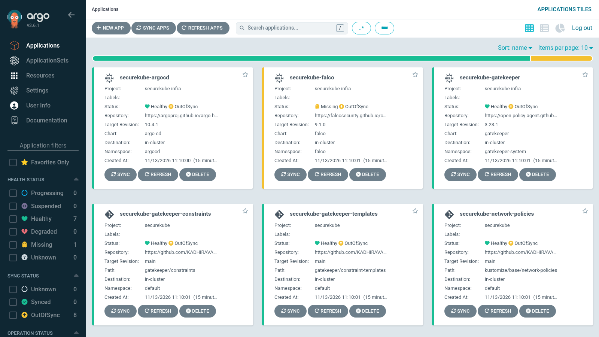
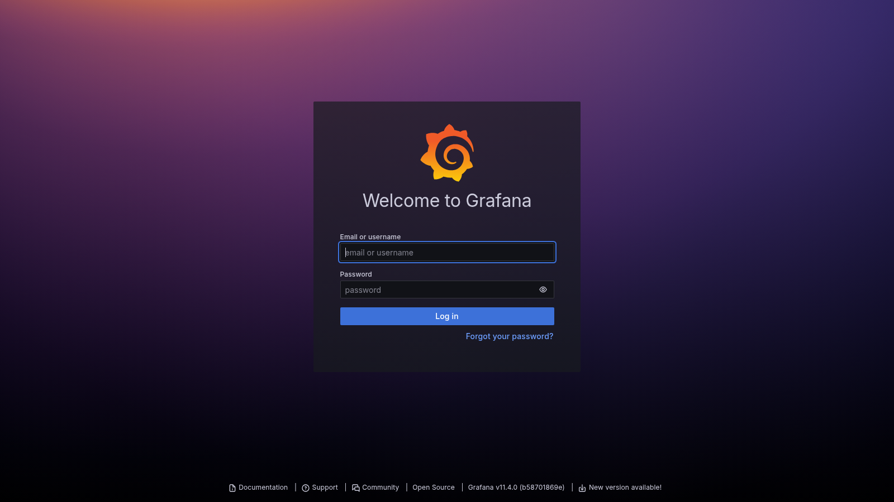
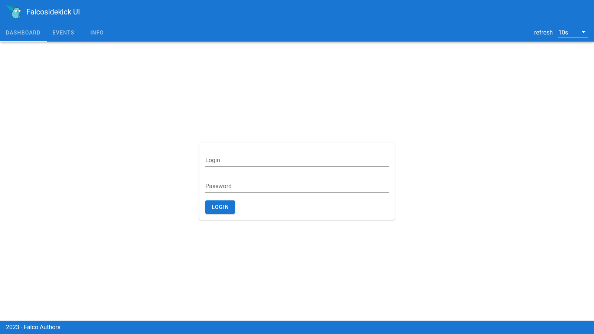
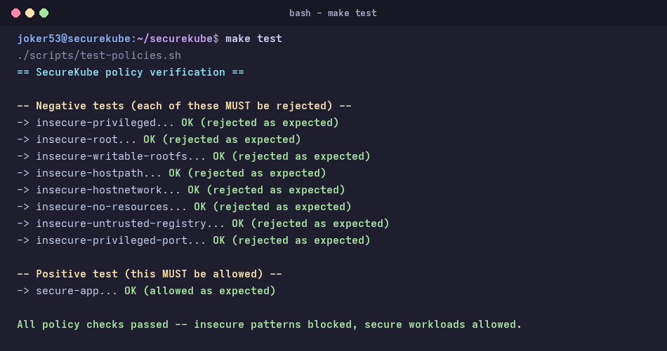
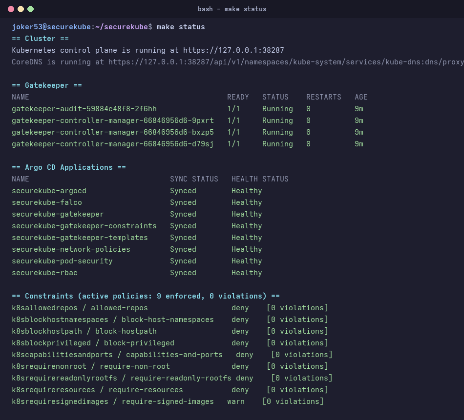

# SecureKube


A CIS-aligned, zero-trust Kubernetes cluster provisioned via IaC — no manual security configuration required, 100% local, zero cloud cost.

## Container image

No local tool installation required — pull the image and run:

```bash
docker run --rm -it \
  -v /var/run/docker.sock:/var/run/docker.sock \
  -v $(pwd):/workspace \
  -w /workspace \
  ghcr.io/joker-53/secure-kube:latest \
  make deploy
```

Or from Docker Hub:

```bash
docker pull joker-53/secure-kube:latest
```

The image bundles `terraform`, `kubectl`, `helm`, `kind`, and the `argocd` CLI at pinned versions. The Docker socket mount is required because `kind` creates cluster nodes as containers on your host Docker daemon.

## Problem statement

Default Kubernetes installations ship with zero network isolation, no pod security standards, and permissive RBAC. Teams adopt K8s fast and configure security slowly — or never. SecureKube eliminates that gap entirely at provisioning time: `make deploy` and the cluster is already hardened.

## Objectives

- CIS Kubernetes Benchmark controls enforced out of the box (see **Known limitations** for what's realistic on `kind`)
- Zero-trust networking via **default-deny NetworkPolicy** across all namespaces
- **Least-privilege RBAC** — no wildcard permissions, no cluster-admin for workloads
- **Pod security standards** — no root containers, no privileged pods, read-only root filesystem, dropped capabilities, no privileged ports
- **Audit logging** and runtime policy enforcement via OPA Gatekeeper (9 constraints) + Falco
- **One-command deployment** — `make deploy`, entirely on `kind` (local), no cloud account, no API keys, no billing

## Visual Showcase & Live Verification

The entire SecureKube stack is fully functional on local Kind clusters, enforced by admission controllers, monitored via eBPF runtime probes, and synced declaratively via GitOps:

### 1. GitOps Continuous Reconciliation (Argo CD)
Every layer — from Calico CNI and Gatekeeper constraints to NetworkPolicies, RBAC, and workload deployments — is monitored for drift and managed declaratively via Argo CD.



---

### 2. Unified Security & Observability Dashboard (Grafana)
Real-time correlation of Gatekeeper policy violations, Falco runtime threat events, cluster resource consumption, and network flow metrics in a single pane of glass.



---

### 3. Runtime Threat Detection & Audit Telemetry (Falco Sidekick)
Falco continuously inspects kernel syscalls via modern eBPF. Anomalies, shell spawns inside containers, and sensitive directory access are streamed to Falco Sidekick UI and Redis.



---

### 4. Admission Control & Policy Enforcement (`make test`)
Automated test suite validates both negative test cases (8/8 non-compliant pods blocked by OPA Gatekeeper and Pod Security Standards) and positive test cases (hardened microservice admitted cleanly).



---

### 5. Multi-Node Cluster Health & Component Status (`make status`)
Single-command overview of the 3-node Kind cluster, Calico networking, Gatekeeper constraint enforcement audit counts, and active services across all security namespaces.



## Architecture

```
1. Provision cluster        kind CLI, driven by Terraform (static kind-config.yaml)
        |
        v
2. Network isolation        Calico CNI + default-deny NetworkPolicy
        |
        v
3. RBAC hardening            Least privilege, no wildcards
        |
        v
4. Policy enforcement        OPA Gatekeeper (9 constraints) + Pod Security Standards
        |
        v
5. Runtime monitoring        Falco (modern eBPF driver) + audit logging
        |
        v
6. Observability & GitOps    kube-prometheus-stack + Grafana + Argo CD
        |
        v
7. CIS validation             kube-bench score reported
        |
        v
   Cluster ready -- secure by default
```

## Tech stack

| Layer | Tool |
|---|---|
| Cluster provisioning | `kind` CLI, invoked from Terraform via `local-exec` |
| Package management | Helm (Gatekeeper, Falco) |
| Namespace policy | Kustomize |
| Local demo target | kind |
| CI validation | GitHub Actions |
| CIS scoring | kube-bench |

## GitOps with Argo CD

Every policy layer (NetworkPolicy, RBAC, Pod Security Standards, Gatekeeper constraints) is registered as an Argo CD `Application` pointing at this repo. Argo CD continuously watches for drift between git and the live cluster, and shows it in a UI — but **won't apply changes automatically** (manual sync mode). You approve each sync explicitly.

```
gitops/
└── apps/
    ├── project.yaml                     Argo CD AppProject (scoped source/destination allow-list)
    ├── calico-system-app.yaml           Calico CNI infrastructure application
    ├── gatekeeper-system-app.yaml       Gatekeeper controller Helm chart
    ├── gatekeeper-templates-app.yaml    OPA ConstraintTemplates
    ├── gatekeeper-constraints-app.yaml  OPA Constraints (cluster-wide enforcement)
    ├── falco-system-app.yaml            Falco & Sidekick UI Helm chart
    ├── network-policies-app.yaml        Kustomize default-deny & DNS-allow network policies
    ├── pod-security-app.yaml            PSA namespace admission profiles
    ├── rbac-app.yaml                    Workload runtime least-privilege RBAC
    └── secure-app.yaml                  Hardened reference application
```

Argo CD is installed as part of `make deploy`. Once up:

```bash
make dashboard-argocd   # open UI at localhost:8080 (prints admin password)
make sync-all           # trigger sync for every layer
make sync-policies      # trigger sync for network policies only
make sync-rbac          # RBAC only
make sync-gatekeeper    # Gatekeeper templates + constraints
make status             # shows Argo CD app health alongside everything else
```

**What GitOps gives you here:**
- Any manual `kubectl apply` someone does outside git gets flagged as drift in the UI
- Policy changes go through git → PR review → merge → manual sync approval, not ad-hoc shell commands
- Full audit trail of what changed, when, and why (git history)

Prerequisites: `terraform`, `kubectl`, `helm`, `kind`, `docker` (with your user in the `docker` group — see Troubleshooting if you hit permission errors).

```bash
git clone <this-repo>
cd securekube
make deploy
```

This runs, in order: `cluster` -> `policies` -> `gatekeeper` -> `falco` -> `test`.

Edit `config.env` to change the cluster name or toggle Calico/Falco before deploying.

### Useful commands

```bash
make status               # health of every component + active constraints + recent violations
make test                 # negative tests (insecure pods rejected) + positive test (secure pod allowed)
make bench                # CIS Benchmark score via kube-bench
make dashboard            # port-forward Falco Sidekick UI to localhost:2802
make dashboard-argocd     # port-forward Argo CD UI to localhost:8080 (prints admin password)
make dashboard-grafana    # port-forward Grafana to localhost:3000 (prints admin password)
make dashboard-prometheus # port-forward Prometheus to localhost:9090
make sync-all             # trigger Argo CD sync across all registered applications
make logs                 # tail live Falco alerts
make clean-logs           # remove stale kube-bench/test job leftovers
make destroy              # tear down everything
```

### Try the example workloads yourself

```bash
kubectl apply -f examples/secure-app.yaml       # should succeed
kubectl apply -f examples/insecure-apps.yaml    # every pod here should be rejected
```

## Repository layout

```
securekube/
├── Makefile                         one-command deploy entrypoint
├── config.env                       cluster name, feature toggles
├── terraform/kind/
│   ├── main.tf                      shells out to the real `kind` CLI (see docs/architecture.md for why)
│   ├── variables.tf
│   ├── outputs.tf
│   ├── kind-config.yaml             static kind cluster config: audit logging, hardened API server flags
│   └── audit-policy.yaml            CIS 3.2.x audit policy
├── kustomize/base/
│   ├── network-policies/            default-deny + DNS-allow NetworkPolicy & egress-templates
│   │   ├── egress-templates/        per-workload egress templates (database, external API)
│   │   └── kustomization.yaml
│   ├── rbac/                        least-privilege Role/RoleBinding, no-wildcard rules
│   └── pod-security/                PSA "restricted" labels per namespace
├── gatekeeper/
│   ├── constraint-templates/        Rego: no-root, no-privileged, readonly-rootfs,
│   │                                 no-hostpath, no-host-namespaces, require-resources,
│   │                                 allowed-repos, capabilities-and-ports, require-signed-images
│   └── constraints/                 activation of each template cluster-wide
├── gitops/apps/                     Argo CD AppProject and 9 declarative application manifests
├── helm/
│   ├── gatekeeper-values.yaml       fail-open webhook (see docs/architecture.md), 3 replicas
│   └── falco-values.yaml            modern_ebpf driver, JSON output, sidekick UI
├── observability/
│   └── dashboards/                  Grafana JSON dashboards (unified security & cluster overview)
├── examples/
│   ├── secure-app.yaml              passes every policy layer -- proves the "happy path" works
│   ├── insecure-apps.yaml           8 pods, each violating exactly one constraint
│   └── three-tier-app.yaml          reference multi-tier workload with isolated network policies
├── scripts/
│   └── test-policies.sh             negative + positive policy tests
├── docs/
│   ├── architecture.md              the real reasoning behind every non-obvious decision
│   └── screenshots/                 live UI & terminal verification captures
└── .github/workflows/ci.yaml        spins up kind, deploys, validates, tears down
```

## Known limitations (read this before treating it as "done")

- **`make bench` will not show a clean pass.** `kind` runs Kubernetes components as containers on your machine, not as a real multi-node control plane — controls around etcd file permissions, kubelet config file ownership, and certain node-level TLS settings can't be satisfied the way they would be on bare metal or a managed node group.
- **`anonymous-auth` is intentionally left enabled** on the API server, despite CIS 1.2.1 recommending it be disabled. Disabling it breaks `kubeadm join`'s bootstrap token discovery outright (a real, reproducible failure we hit and fixed — see `docs/architecture.md`). RBAC + NodeRestriction constrain what an unauthenticated request can actually do instead.
- **Gatekeeper's webhook is fail-open (`Ignore`), not fail-closed (`Fail`).** Fail-closed causes an unrecoverable deadlock with Calico's cluster-scoped IPAM CRDs on this stack (also a real failure we hit — full explanation in `docs/architecture.md`). This means there's a brief enforcement gap any time the webhook pod restarts.
- **The allowed-repos list ships permissive** (`docker.io/library/`, `ghcr.io/`, `gcr.io/`, `registry.k8s.io/`) so the bundled examples work out of the box. Tighten `gatekeeper/constraints/allowed-repos-constraint.yaml` to your actual registry before treating this as a real supply-chain control.

## Troubleshooting

| Symptom | Likely cause | Fix |
|---|---|---|
| `permission denied ... docker.sock` | Your user isn't in the `docker` group, or the group change hasn't taken effect yet | `sudo usermod -aG docker $USER`, then fully log out and back in (not just `newgrp`) |
| `make cluster` / `kind create cluster` hangs or is slow | Normal on first run — pulling `kindest/node` image (~1GB+) | Let it run; check `docker images \| grep kindest` to confirm the pull is progressing |
| Worker nodes never join, `kubeadm join` retries forever | `anonymous-auth: false` breaks kubeadm's bootstrap token discovery | Already fixed in this repo's `kind-config.yaml` — don't re-add that flag |
| Gatekeeper pods stuck `ContainerCreating` forever, referencing its own webhook in events | Fail-closed webhook deadlocked against Calico's cluster-scoped IPAM CRDs | Already fixed via `validatingWebhookFailurePolicy: Ignore` in `helm/gatekeeper-values.yaml` |
| `helm install falco` fails with `driver.kind=ebpf ... no longer supported` | Falco chart renamed the value | Already fixed — `helm/falco-values.yaml` uses `modern_ebpf` |
| `kubectl apply` fails with `invalid object to validate` right after installing a new CRD | Stale local kubectl schema cache | `rm -rf ~/.kube/cache` and retry |
| `make test` — secure-app gets rejected on `seccompProfile` | Pod Security Standards' `restricted` profile requires `securityContext.seccompProfile.type: RuntimeDefault` | Already set in `examples/secure-app.yaml` |
| `make bench` hangs, `kubectl wait` times out on `job/kube-bench` | `kube-bench` needs `hostPID`/`hostPath`, which our own restricted PSA on `default` blocks | Already fixed — `make bench` now runs it in `kube-system`, which is intentionally unlabeled for system tooling |
| Port 2802 already in use (`make dashboard`) | Another process is bound to it | `kubectl port-forward -n falco svc/falco-falcosidekick-ui <free-port>:2802` manually |
| `make destroy` leaves resources behind | Terraform state drift after manual `kubectl`/`kind` changes | `kind delete cluster --name securekube` as a manual fallback |

## References

- CIS Kubernetes Benchmark v1.8 -- https://www.cisecurity.org/benchmark/kubernetes
- NSA/CISA Kubernetes Hardening Guide (2022) -- https://media.defense.gov
- NIST SP 800-190, Application Container Security Guide
- Kubernetes Pod Security Standards -- https://kubernetes.io/docs/concepts/security/pod-security-standards

## Roadmap

- [x] GitOps layer — Argo CD managing all policy layers (NetworkPolicy, RBAC, PSA, Gatekeeper constraints)
- [x] GitOps for Helm releases (Gatekeeper, Falco, Argo CD itself as Argo CD Applications)
- [ ] EKS Terraform module (IAM Roles for Service Accounts, VPC CNI + NetworkPolicy)
- [ ] GKE Terraform module (Workload Identity, GKE Sandbox / gVisor)
- [ ] Image signing/verification via Cosign + Gatekeeper
- [ ] Secrets management via External Secrets Operator
- [x] Per-workload egress NetworkPolicy allow-lists
