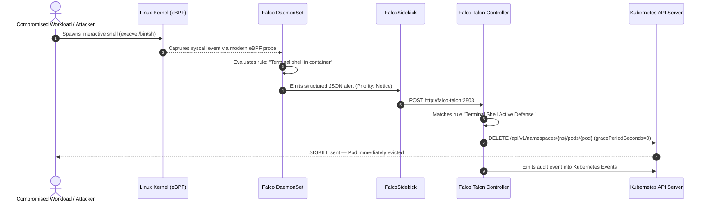

# Active Threat Defense & Pod Quarantine

SecureKube transforms traditional runtime security from **passive logging** into **active, zero-trust automated enforcement**.

Using the official [Falco Talon](https://github.com/falcosecurity/falco-talon) response engine integrated with Falco's modern eBPF driver, the cluster detects in-flight exploitation and terminates compromised workloads or isolates them into network quarantine within milliseconds.

---

## 🏗️ Architecture



---

## ⚙️ Configuration & Remediation Rules

Falco Talon is configured via `helm/falco-talon-values.yaml`. Rules combine actions with pattern matching on Falco event tags and rule names:

```yaml
config:
  watchRules: true
  deduplication:
    leaderElection: false
    timeWindowSeconds: 5

  rulesOverride: |
    # Action 1: Terminate the compromised pod immediately
    - action: Terminate Compromised Pod
      actionner: kubernetes:terminate
      parameters:
        grace_period_seconds: 0
        ignore_daemonsets: true
        ignore_statefulsets: false

    # Action 2: Apply zero-trust network quarantine label
    - action: Quarantine Suspicious Pod
      actionner: kubernetes:label
      parameters:
        labels:
          security.securekube.io/quarantine: "true"

    # Rule 1: Rogue terminal shell inside container -> Immediate pod termination
    - rule: Terminal Shell Active Defense
      description: "Terminate any pod where an interactive terminal shell is executed"
      match:
        rules:
          - "Terminal shell in container"
        namespaces:
          not:
            - kube-system
            - falco
            - gatekeeper-system
            - monitoring
            - argocd
            - calico-system
            - external-secrets
      actions:
        - Terminate Compromised Pod

    # Rule 2: Credential theft or sensitive file read -> Quarantine & Terminate
    - rule: Sensitive File Access Defense
      description: "Terminate any pod reading sensitive credentials or host files"
      match:
        rules:
          - "Read sensitive file untrusted"
          - "Write below etc"
        namespaces:
          not:
            - kube-system
            - falco
            - gatekeeper-system
            - monitoring
            - argocd
            - calico-system
            - external-secrets
      actions:
        - Quarantine Suspicious Pod
        - Terminate Compromised Pod
```

---

## 🚀 Installation & Verification

### Install Falco Talon

```bash
make talon
```

Verify that the Talon controller is active:

```bash
kubectl get pods -n falco -l app.kubernetes.io/name=falco-talon
```

### Run Active Defense Verification

SecureKube provides a dedicated automated verification test (`make test-active-defense`):

```bash
make test-active-defense
```

This test:
1. Deploys a compliant pod in the `default` namespace.
2. Simulates an unauthorized interactive terminal execution (`sh -c 'uname -a'`).
3. Verifies that Falco captures the event via eBPF, dispatches to Talon via FalcoSidekick, and terminates the container.
4. Asserts that the workload enters `Terminating` or deleted state automatically.
