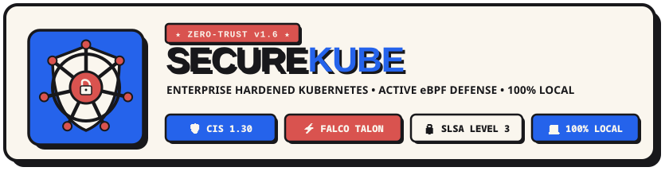
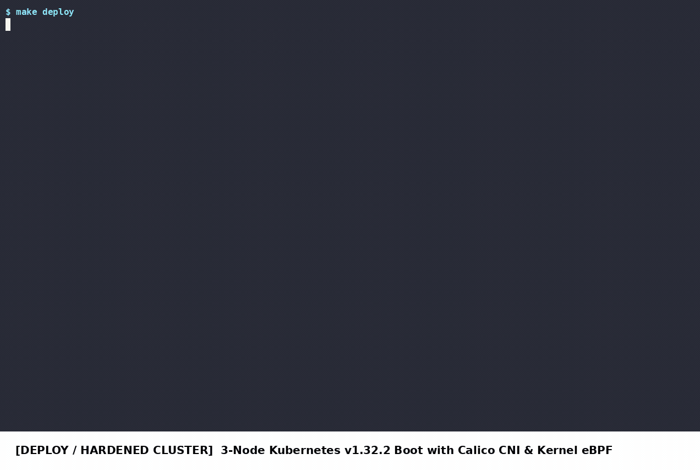
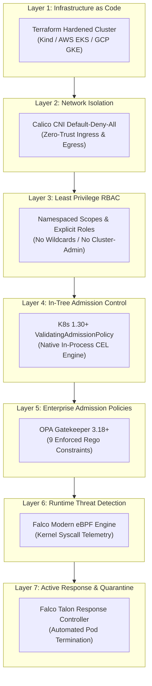

# SecureKube

<p align="center">
  <picture>
    <source media="(prefers-color-scheme: dark)" srcset="assets/banner-dark.png">
    <source media="(prefers-color-scheme: light)" srcset="assets/banner-light.png">
    
  </picture>
</p>

<p align="center">
  <strong>Enterprise-Grade, CIS-Hardened, Zero-Trust Kubernetes Security Blueprint</strong><br>
  <em>100% Local Development • Zero Cloud Cost • Fully Automated Defense</em>
</p>

<p align="center">
  
  
  
  
  <br>
  
  
  
  
</p>

<p align="center">
  
</p>

---

## ⚡ Quickstart

### Option A: Zero Tool Installation (Pre-Packaged Docker Image)

No local `terraform`, `kubectl`, `helm`, or `kind` required:

```bash
docker run --rm -it \
  -v /var/run/docker.sock:/var/run/docker.sock \
  -v $(pwd):/workspace \
  -w /workspace \
  ghcr.io/kadhiravaneg/secure-kube:latest \
  make deploy
```

### Option B: Local CLI

```bash
git clone https://github.com/KADHIRAVANEG/secure-kube.git
cd secure-kube
make deploy
```

In under 5 minutes, you have a 3-node Kubernetes cluster with **7 active defense layers**, zero-trust network isolation, and runtime eBPF monitoring.

---

## 🛡️ The 7-Layer Defense Matrix



| Layer | Technology | Security Function |
|---|---|---|
| **1. Infrastructure** | Terraform + Kind / EKS / GKE | CIS-hardened API server flags, KMS envelope encryption, IMDSv2 |
| **2. Network** | Calico CNI | Zero-trust default-deny on all namespaces; explicit microservice allowlists |
| **3. Identity & RBAC** | Kubernetes RBAC | Zero cluster-admin bindings; read-only default service accounts |
| **4. In-Tree Admission** | K8s 1.30+ CEL Policies | Sub-millisecond, zero-network-hop admission validation |
| **5. Policy Enforcement** | OPA Gatekeeper | 9 constraints: no-root, no-privileged, readonly-rootfs, no-hostpath, repos |
| **6. Runtime Telemetry** | Falco (Modern eBPF) | Kernel-level detection of terminal shells, file tampering, and privilege escalations |
| **7. Active Defense** | Falco Talon | Automated incident response: pod termination and zero-trust quarantine |

---

## 🎯 8-Vector Automated Offensive Assault Suite

SecureKube includes an integrated assault suite (`make attack`) that executes 8 real-world cyber attack scenarios against the cluster and verifies active neutralization:

```bash
make attack
```

```text
========================================================================
       SecureKube Automated Security Assault & Defense Simulator        
========================================================================
Target Cluster: kind-securekube
Defense Stack:  Calico CNI + OPA Gatekeeper + Falco eBPF + PSA Restricted
Simulating 8 offensive attack vectors...

[Attack 1/8] Privilege Escalation: Root container escape via CAP_SYS_ADMIN
  ✓ BLOCKED AT ADMISSION: Malicious pod creation rejected
  Defense Layer: Kubernetes Pod Security Admission (restricted profile)

[Attack 2/8] Host Escape: Mounting node root filesystem via hostPath
  ✓ BLOCKED AT ADMISSION: Malicious pod creation rejected
  Defense Layer: Kubernetes Native In-Tree CEL ([CEL:no-hostpath])

[Attack 3/8] Network Sniffing: Intercepting node traffic via hostNetwork
  ✓ BLOCKED AT ADMISSION: Malicious pod creation rejected
  Defense Layer: Kubernetes Native In-Tree CEL ([CEL:no-hostnetwork])

[Attack 4/8] Supply Chain: Deploying image from untrusted rogue registry
  ✓ BLOCKED AT ADMISSION: Malicious pod creation rejected
  Defense Layer: OPA Gatekeeper Admission Controller ([allowed-repos])

[Attack 5/8] Port Hijack: Listening on privileged port 80 without root
  ✓ BLOCKED AT ADMISSION: Malicious pod creation rejected
  Defense Layer: OPA Gatekeeper Admission Controller ([capabilities-and-ports])

[Attack 6/8] Denial of Service: Unbounded noisy-neighbor memory exhaustion
  ✓ BLOCKED AT ADMISSION: Malicious pod creation rejected
  Defense Layer: OPA Gatekeeper Admission Controller ([require-resources])

[Attack 7/8] Lateral Pivoting: Cross-namespace unauthorized database probe
  ✓ BLOCKED BY NETWORK POLICY: Calico dropped unauthorized lateral packets
  Defense Layer: Calico CNI + Default-Deny NetworkPolicy

[Attack 8/8] Runtime Exploit: Unauthorized shell execution inside container
  ✓ DETECTED BY RUNTIME EBPF: Falco eBPF driver active and monitoring syscalls
  ✓ ACTIVE RESPONSE ENGINE: Falco Talon armed for automated pod termination & quarantine
  Defense Layer: Falco Kernel eBPF Telemetry Engine

========================================================================
                  DEFENSE SUMMARY & RESILIENCE SCORE                    
========================================================================
Attacks Simulated: 8
Threats Blocked:   8
Defense Efficiency: 100% (MAXIMUM RESILIENCE)
Status: ALL 8 OFFENSIVE ATTACKS NEUTRALIZED BY SECUREKUBE HARDENING
========================================================================
```

---

## 📊 Management & Observability Dashboards

Once deployed, SecureKube provides operational web interfaces out of the box:

```bash
make dashboard-grafana    # http://localhost:3000 (admin / securekube-admin)
make dashboard-prometheus # http://localhost:9090
make dashboard-argocd     # http://localhost:8080 (GitOps continuous sync)
make dashboard            # http://localhost:2802 (Falco Sidekick live alerts)
```
