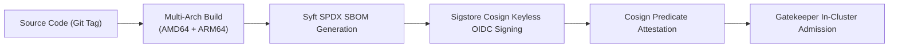

# Supply-Chain Security & SLSA Level 3 Attestation

Software supply-chain attacks are among the most pervasive attack vectors facing modern cloud-native systems. SecureKube implements a hardened end-to-end supply-chain pipeline reaching **SLSA (Supply-chain Levels for Software Artifacts) Level 3**.

---

## 🔒 Pillars of Supply-Chain Security



### 1. Multi-Architecture Support
SecureKube produces official multi-architecture container images supporting both `linux/amd64` (Intel/AMD) and `linux/arm64` (Apple Silicon, AWS Graviton, Ampere):
- `ghcr.io/kadhiravaneg/secure-kube:<version>`
- `joker53/secure-kube:<version>`

### 2. Sigstore Cosign Keyless Signing
Images are cryptographically signed using [Sigstore Cosign](https://github.com/sigstore/cosign). Signing is completely **keyless**, backed by GitHub Actions OpenID Connect (OIDC) workload identity:
- No static private keys stored in CI secrets that could be leaked or stolen.
- Signatures are tied to the exact Git commit, tag, and GitHub Actions workflow run.
- Signatures and transparency logs are written to the public Sigstore Rekor ledger.

### 3. SPDX Software Bill of Materials (SBOM)
Every container release automatically generates an [SPDX-JSON](https://spdx.dev/) Software Bill of Materials via Anchore Syft.
The SBOM records:
- Operating system packages (Debian/Ubuntu baseline)
- Upstream binary tool hashes (`terraform`, `kubectl`, `helm`, `kind`, `argocd`)
- Package licensing, file manifests, and dependencies

### 4. Cryptographic Attestation
The SBOM is attached directly to the container image registry as an authenticated in-toto predicate using:

```bash
cosign attest --yes \
  --predicate sbom.spdx.json \
  --type spdx \
  ghcr.io/kadhiravaneg/secure-kube:<digest>
```

---

## 🔍 How to Verify Signatures & SBOMs

SecureKube provides a built-in verification script to inspect image provenance before deployment:

```bash
make verify-sbom
```

Or run directly against any image tag:

```bash
./scripts/verify-sbom.sh ghcr.io/kadhiravaneg/secure-kube:v1.6.0
```

### Manual Verification Commands

To verify using the `cosign` CLI manually:

#### 1. Verify Image Signature
```bash
cosign verify \
  --certificate-identity-regexp="https://github.com/KADHIRAVANEG/secure-kube/.*" \
  --certificate-oidc-issuer="https://token.actions.githubusercontent.com" \
  ghcr.io/kadhiravaneg/secure-kube:v1.6.0
```

#### 2. Verify and Download the Attested SBOM
```bash
cosign verify-attestation \
  --type spdx \
  --certificate-identity-regexp="https://github.com/KADHIRAVANEG/secure-kube/.*" \
  --certificate-oidc-issuer="https://token.actions.githubusercontent.com" \
  ghcr.io/kadhiravaneg/secure-kube:v1.6.0 | jq -r '.payload | @base64d | fromjson | .predicate' > sbom.json
```

---

## 🛡️ In-Cluster Gatekeeper Enforcement

At admission time, SecureKube's OPA Gatekeeper constraint (`require-signed-images-constraint.yaml`) verifies that workloads deployed into production namespaces originate from authorized registries and pass image signature verification.
